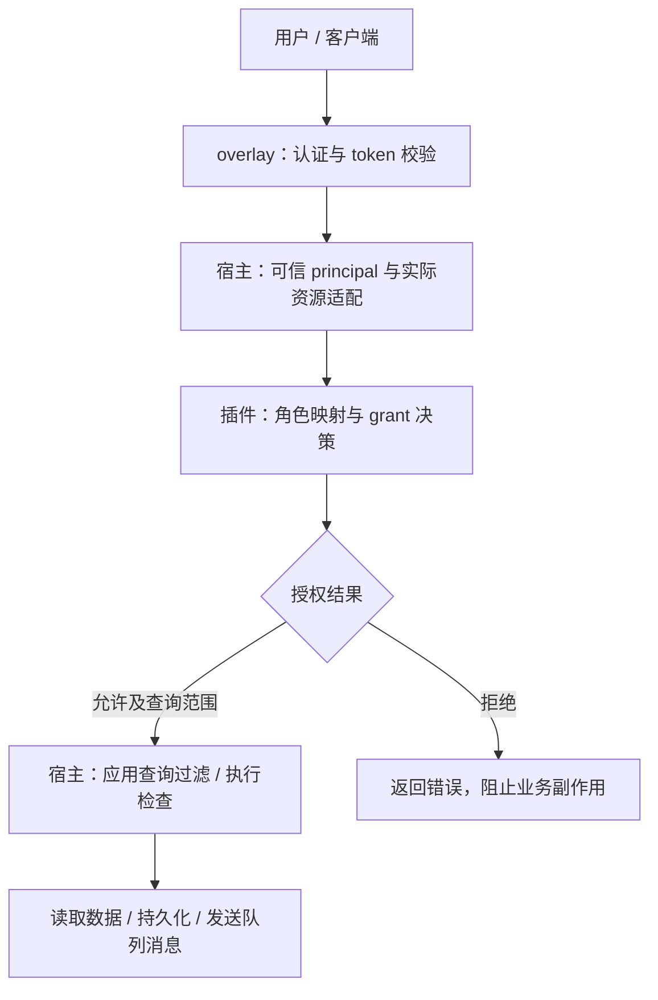
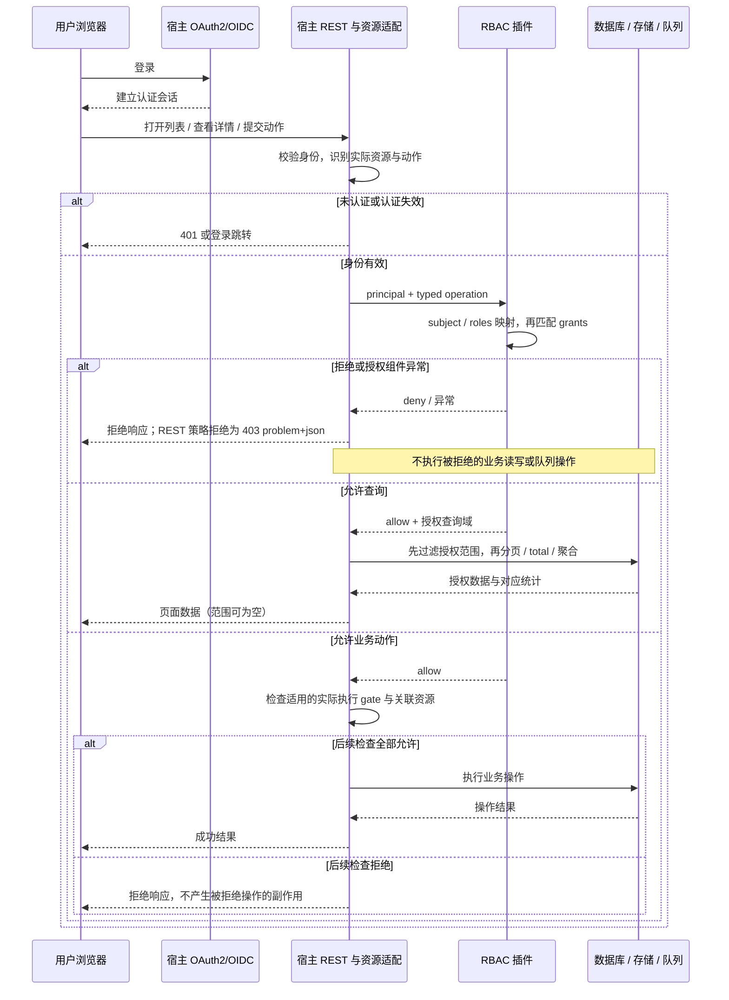
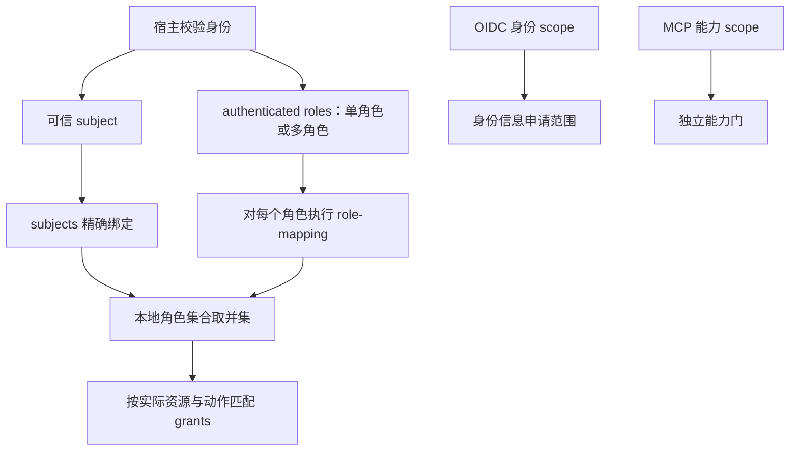
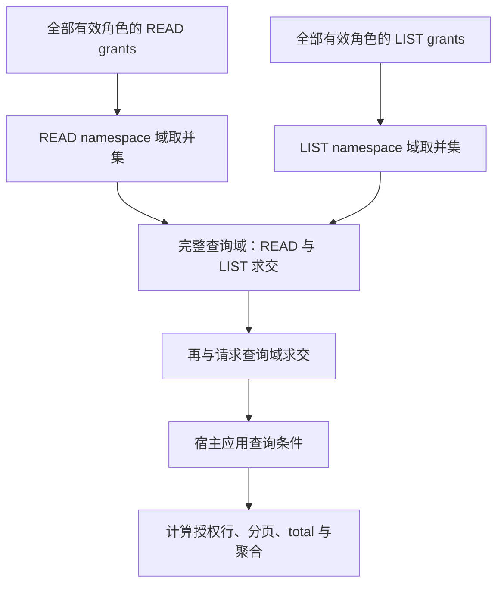
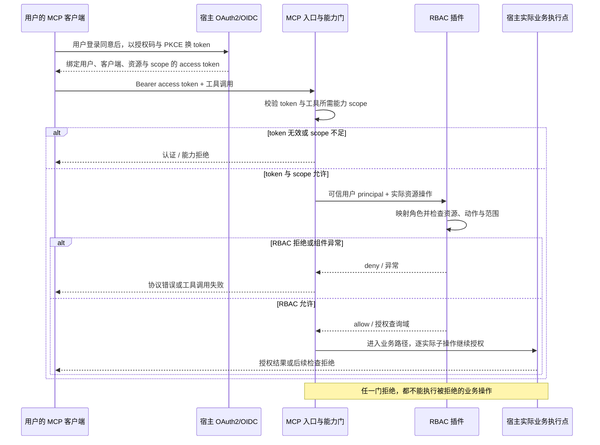

# OAuth2/OIDC 到 RBAC 的运行机制

当前运行时策略来自插件应用组目录中当前Kestra应用的统一权限实体。管理身份来自
有效组scope所激活的实际managementGrants，不来自management-admin-subjects、旧角色
映射或永久subject旁路。下方roles、role-mapping、instance-admin-roles和subjects绑定的
示例仅保留为历史机制说明，不是当前部署入口，也不能作为新模式授权或验收依据。

当前路径为：宿主校验标准账号/client和签名，建立可信应用组身份；插件在当前事务
快照中核对issuer、应用、audience、组状态、epoch、支持与授予，再按同scope完整
授权规则评估typed操作。统一权限的scopeKeys形成支持并集，与用户持久授予求交；
外部details不参与本实例执行授权。纯metadata修订不误撤权，实际策略快照最长
60秒后失败关闭。具体模型及候选/正式边界见 `application-groups.md`。

当前账号删除路径为：宿主安全锁与可信actor重验 → 同连接插件参与者复查权限、
拒绝自身、清理全组授予并保护最后管理员 → 宿主物理删除账号和撤销协议凭据 →
一次提交。任一异常全部回滚。正式插件 d099 已消费 UserDirectoryV2 与
IdentityLifecycleParticipantV1/TrustedIdentityV2，账号删除和参与者已接线；成功 CI
`40950658945` 的 Java/PG 检查证明独立能力层，不仅是内部清理方法测试。生产
HTTP/UI/Compose 的最终组合仍须由部署仓验收，不能由上述独立结果推定通过。

本文解释一次请求从登录到业务执行如何经过 OAuth2/OIDC、宿主授权上下文、MCP 能力 scope
和 RBAC policy。本文描述运行时机制和边界，不是安装步骤、配置参考或测试清单。

## 参与者和责任

overlay 是认证和宿主适配边界。它读取并校验 token，建立可信 principal，把实际操作编码
为版本化 typed operation，并在查询、运行时执行和 MCP 入口调用授权器。插件只实现业务
授权策略，不验证 JWT，不读取原始身份 header，不解析 URL、Controller 或前端路由。

## 用户看到的流程与角色来源

用户登录后可以打开页面；页面请求的数据和提交的动作仍逐次授权。登录成功不代表所有
菜单、namespace 或写操作都可用。用户不能通过改变请求参数、token 的显示内容或前端按钮
获得更多权限。

**角色不从 OAuth token 的 `scope` 推导。** OAuth2/MCP 能力 scope、OIDC 身份 scope 和
RBAC 角色是不同概念：

| 信息 | 含义 | 谁使用 |
|---|---|---|
| OIDC 身份 scope | 申请身份信息范围，例如 `openid`；不授予业务资源权限 | 宿主认证流程 |
| MCP 能力 scope | 客户端获准使用的资源大类 read/write/delete 能力 | 宿主 MCP scope 门 |
| 可信 subject 与 authenticated roles | 宿主校验认证结果后提供的用户身份与角色值 | 插件 subject/role 映射 |
| 本地角色与 grants | 部署配置定义的资源、动作、namespace 和 ID 权限 | 插件 policy engine |

插件只消费宿主提供的可信 principal，不自行解码 token 来认定角色。有效本地角色集合为：

以下例子用于解释映射机制，角色名称和权限必须由实际部署配置定义：

| 用户 | 宿主提供的 roles | 映射后的本地角色 | 结果 |
|---|---|---|---|
| 只读用户 | `[reader]` | `role-mapping.reader` 中的角色 | 只获得对应 READ/LIST 等 grants |
| 写入用户 | `[writer]` | `role-mapping.writer` 中的角色 | 只有显式配置的 CREATE/UPDATE/EXECUTE/DELETE 等动作可用 |
| 多角色用户 | `[reader, writer]` | 两组映射结果的并集，加 subject 绑定 | 分别合并每个动作可访问的资源域 |
| 未映射用户 | `[unknown]` | 仅可能有精确 subject 绑定 | 未知 presented role 不自动授予任何权限 |
| 实例管理员 | `[admin]` | 显式映射到列入 `instance-admin-roles` 的本地角色 | 允许合法宿主操作，但仍受认证、CSRF 和 MCP scope 门约束 |

本地角色同名不代表自动映射。例如 principal 携带 `deployment-admin`，若没有相应
`role-mapping` 或 subject 绑定，不能因此成为实例管理员。多角色授权也不是把所有资源域
和所有动作做任意组合：每个动作先合并其匹配 grant，完整查询再计算 READ 与 LIST 域交集。

## 一次 REST 请求的内部步骤

1. 用户通过 OIDC 完成登录。浏览器取得宿主认可的认证会话；API 客户端携带 access token。
2. overlay 校验认证结果，提取不可变 subject、authenticated roles、tenant 和请求来源。
   未登录请求由宿主返回 401 或跳转登录；插件不会把匿名请求转换为内部请求。
3. 宿主把实际资源、动作、tenant、namespace、资源 ID 和查询域编码为 typed operation。
   插件接收操作和 principal，不接收路由字符串。
4. 插件将 subject 和已认证 role 映射到本地角色，再合并匹配 grant。默认拒绝；未知主体、
   未知角色、非法版本、缺少身份或未解析操作都拒绝。
5. 单资源操作返回 allow 或 deny。集合查询还返回授权 namespace scope；宿主在分页、总数、
   聚合和实际 SQL/日志条件之前应用该 scope。ID 限制的 grant 不能推导完整集合权限。
6. 宿主只在授权通过后继续执行。创建、更新、删除、执行等操作还必须经过实际运行时 gate；
   拒绝不得写入数据库、创建 pending execution、发送队列消息或产生其他业务副作用。

## namespace、ID 和多角色合并

资源范围由宿主实际操作与插件配置共同确定。宿主识别资源类型、实际 namespace、ID、
所属 tenant，以及查询或复合操作涉及的资源；插件用匹配的 grants 计算允许范围。例如
Flow 列表的 namespace 来自查询域，Execution 的归属由宿主解析，展开 subflow 使用目标
Flow 的 owner namespace。前端传入 namespace 不构成可信归属证明。

角色 grant 的作用域是精确的。namespace 子树只在明确声明 `descendants: true` 时匹配，
相似前缀不匹配。具体资源 ID 必须显式列出或声明 `all-ids: true`；空 ID 集合授予零个 ID。

多个角色分别贡献权限。READ 和 LIST 可以来自不同角色，但完整查询的有效 namespace 必须
同时属于 READ 与 LIST 的交集。请求查询域再与该授权 scope 求交，用户提供的过滤条件不能
扩大授权范围。INSTANCE、TENANT、NAMESPACE 作用域不会自动向上提升。

## MCP 的两层门

MCP 请求先经过 OAuth2 token 和 MCP 能力 scope 门，再进入同一 typed RBAC 授权器：

scope 是能力类别，不是角色，也不直接授予某个 Flow 或 namespace。`write` 不包含 `delete`。
scope 缺失时，即使 RBAC 允许也拒绝；scope 允许但 RBAC 拒绝时同样拒绝。两种拒绝都必须
在业务执行前发生，并且没有持久化或队列副作用。REST 和 MCP 对同一资源动作使用一致的
subject、role 和 grant 语义。

## 查询、dashboard 和执行的差异

- **资源查询**：授权器返回可用域，宿主将域翻译为 SQL、log store 或 dashboard 查询条件，
  并在分页和 total 计算前应用。
- **dashboard**：每个实际 `fetchData` 或 `fetchValue` 查询单独授权；KPI 分子和分母分别
  产生操作。global filter 只能收窄授权域，未知 datasource 拒绝。
- **Flow 执行**：入口操作通过后，宿主还在实际执行 gate 检查 runtime ProcessedFlow、
  invocation namespace、Flow ID 和依赖声明。普通用户使用保守的输入、变量、secret、KV、
  file 和 output 表达式规则；管理员的额外依赖列表是显式的空集合，不代表关闭宿主其他安全门。
- **Execution graph/subflow**：读取父图或展开 subflow 时，宿主必须检查实际目标 Flow 的
  owner namespace。父 execution 已获准不能替代目标 Flow 的授权。

## 上下文和异步执行

HTTP 身份和授权来源属于请求上下文。上下文缺失且没有显式内部入口标记时，插件返回拒绝；
不能因线程、任务名称或调用位置推断内部权限。宿主可以为明确的内部 engine/queue 入口
建立内部上下文，但该入口必须由宿主代码显式标记。

异步任务只传播授权来源和必要身份，不传播整个 Micronaut context、JDBC connection 或
transaction。长生命周期 queue subscriber 使用明确的内部语义。这样既保持授权来源可追踪，
又避免把已经关闭的请求连接带入后台任务。

## 拦截结果如何回到前端

| 条件 | 服务端处理 | 用户可观察的结果 |
|---|---|---|
| 未认证或认证失效 | 宿主认证层拒绝 | API 返回 401，或浏览器进入登录跳转流程 |
| 已认证但 RBAC 不允许实际操作 | 宿主执行插件决策，阻止业务操作 | REST 返回 403 与 `application/problem+json` 错误；页面按宿主已有错误处理显示失败 |
| 集合查询获准但授权范围受限 | 宿主先应用查询 scope | 仅返回授权行和对应 total；空受限域返回空结果，不能回退全域 |
| MCP scope 不足或 RBAC 拒绝 | MCP 门阻止工具执行 | 客户端收到协议错误或工具调用失败；不能把 REST 403 当作全部 MCP 响应格式 |
| RBAC 开启但组件缺失或决策异常 | 宿主失败关闭 | 操作失败，不能因为插件未装载而继续业务执行 |

插件不直接渲染页面，不决定 toast 文案，也不保证按 grants 隐藏每个菜单或按钮。用户可能
看到按钮后收到拒绝；安全边界在服务端。UI 验收必须同时检查错误呈现和操作前后持久化
状态，不能把前端显示“失败”当作没有业务副作用的证据。

## 失败关闭条件和能力边界

以下情况均必须拒绝：授权器缺失或抛异常、contract version 未知、principal 不完整、操作
无法解析、scope 或资源域非法、依赖组件缺失，以及策略配置引用未定义角色。RBAC 关闭时，
宿主恢复其既有认证和业务行为；插件不因此实现宿主没有的 EE 页面或资源。

本插件不负责 OAuth2/OIDC 登录、JWT 验证、MCP token 签发、前端菜单隐藏、任务沙箱或宿主
查询实现。上述边界由 overlay 和部署组合共同保证；插件负责把可信 principal 和 typed
operation 转换为可审计的 RBAC 决策。

## 如何判断链路真的生效

单元测试只能证明 grant 合并和策略语义。完整链路必须使用已发布 overlay 镜像、独立编译
的插件 jar 和真实认证流程验证：允许请求能读取正确范围，拒绝请求返回预期错误；scope/RBAC
任一层拒绝都没有数据库、pending execution 或队列副作用；缺少插件和关闭 RBAC 的回归行为
仍然满足宿主契约。最终证据由部署仓的 Compose 验收提供。
